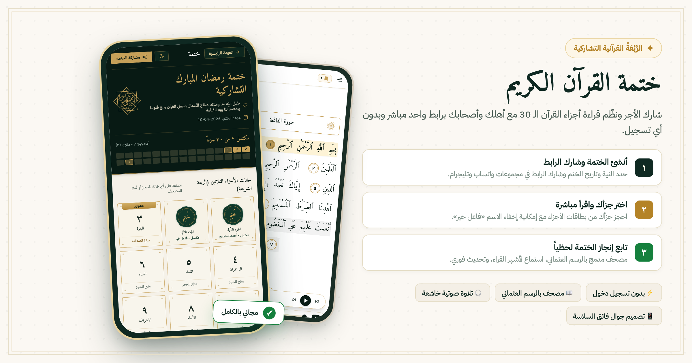

# 📖 Khatma (ختمة) — Collaborative Quran Completion

> **A serene, real-time platform to coordinate, reserve, and read the 30 Juz' of the Holy Quran together with family and friends — no sign-up required.**



---

## 🌟 Overview

**Khatma** transforms how communities, families, and friends complete the Holy Quran together. Rather than coordinating through messy chat lists or spreadsheets where readers must constantly switch between apps, Khatma provides a unified, mobile-first experience:

1. **Create a Khatma** with a title, intention (*niyyah*), and target completion date.
2. **Share a simple link** via WhatsApp, Telegram, or social media.
3. **Reserve any of the 30 Juz'** in two taps, with optional anonymity ("فاعل خير").
4. **Read directly in the browser** with an authentic Uthmani Mushaf reader, audio recitation, and automatic bookmarking.
5. **Celebrate completion** with the traditional *Dua' Khatm Al-Quran* when all 30 Juz' are finished.

---

## ✨ Key Features

### 🏛️ The 30-Juz Rab'ah Grid
- Displays all 30 Quranic parts (*Ajza'*) in an authentic architectural card matrix.
- Real-time status badges: **Available**, **Reserved**, and **Completed**.
- Live progress counter and visual completion bar.

### 🔒 Privacy & Access Control
- **Dedicated Reading Access**: Once a Juz' is reserved or marked completed, **only the reader who claimed it** can open its reader view. Other participants see a polite notice indicating who holds or completed the part.
- **Anonymous Participation**: Readers can toggle the "فاعل خير" option to keep their name private from other participants while preserving coordination.
- **Zero Friction**: Powered by Firebase Anonymous Authentication and `localStorage` — no email or password required.

### 📜 Surah Breakdown in Reservation Modal
- Before reserving, participants can see the exact list of Surahs included in that specific Juz' (from 1 Surah up to 37 Surahs in *Juz 'Amma*), complete with counts and elegant badges.

### 📖 Immersive In-App Mushaf Reader
- **Authentic Script**: Verified Uthmani text sourced directly from [Tanzil.net](https://tanzil.net).
- **Audio Reciter Bar**: Listen verse-by-verse to renowned reciters:
  - Mishary Rashid Alafasy
  - Yasser Al-Dosari
  - Mohamed Siddiq El-Minshawi
  - Mahmoud Khalil Al-Hussary
  - Abdulbasit Abdulsamad
  - Ahmed Al-Ajmi
  - Islam Sobhi (with millisecond-accurate verse timestamps)
- **Illuminated Night Mushaf**: Thoughtful dark mode designed to prevent eye strain during night-time recitation (*Qiyam*).
- **Reading Comfort**: Dynamic font scaling, Surah cartouche headers, Ayah medallions, and automatic scroll saving.

### 🤲 Khatm Celebration
- When all 30 Juz' are marked completed, the page dynamically unlocks the traditional **Dua' Khatm Al-Quran** (*دعاء ختم القرآن الكريم*) and celebratory blessing banners.

---

## 🛠️ Tech Stack

- **Framework**: [Next.js 15](https://nextjs.org/) (App Router, Server Components & Client Hydration)
- **Language**: [TypeScript](https://www.typescriptlang.org/) (Strict typing)
- **Styling**: [Tailwind CSS](https://tailwindcss.com/) with custom Islamic emerald & warm gold palette
- **Database & Auth**: [Firebase](https://firebase.google.com/) (Cloud Firestore for real-time sync + Anonymous Auth)
- **Quran Data**: Static, pre-compiled JSON files derived from [Tanzil.net](https://tanzil.net) Uthmani dataset
- **Testing**: [Vitest](https://vitest.dev/) + [React Testing Library](https://testing-library.com/) + [Playwright](https://playwright.dev/)
- **Icons**: [Lucide React](https://lucide.dev/)

---

## 🚀 Getting Started

### Prerequisites

- **Node.js**: v18.18 or newer
- **npm** or **pnpm** / **yarn**

### 1. Clone the Repository

```bash
git clone https://github.com/Basel-brg/khatma.git
cd khatma
```

### 2. Install Dependencies

```bash
npm install
```

### 3. Configure Environment Variables

Create a `.env.local` file in the root directory and add your Firebase credentials:

```env
NEXT_PUBLIC_FIREBASE_API_KEY=your_api_key
NEXT_PUBLIC_FIREBASE_AUTH_DOMAIN=your_project_id.firebaseapp.com
NEXT_PUBLIC_FIREBASE_PROJECT_ID=your_project_id
NEXT_PUBLIC_FIREBASE_STORAGE_BUCKET=your_project_id.appspot.com
NEXT_PUBLIC_FIREBASE_MESSAGING_SENDER_ID=your_messaging_sender_id
NEXT_PUBLIC_FIREBASE_APP_ID=your_app_id
```

> **Note:** If Firebase credentials are not provided, the application automatically falls back to an in-memory / local storage mock service for seamless local development and offline testing.

### 4. Run Development Server

```bash
npm run dev
```

Open [http://localhost:3000](http://localhost:3000) in your browser.

---

## 🧪 Testing

The repository contains automated unit, integration, and UI tests:

```bash
# Run unit & component tests with Vitest
npm test

# Run tests in watch mode
npm run test:watch

# Run end-to-end tests with Playwright
npx playwright test
```

---

## 📁 Project Structure

```
├── public/
│   ├── quran/                 # 30 pre-chunked Tanzil Uthmani Juz' JSON files
│   ├── og-image.png           # Social preview banner
│   └── favicon.svg            # Islamic geometric favicon
├── src/
│   ├── app/
│   │   ├── layout.tsx         # Root layout with OpenGraph metadata & Arabic font
│   │   ├── page.tsx           # Home landing page with active Khatmas & creation
│   │   └── khatma/[id]/       # Dedicated dynamic Khatma page
│   ├── components/
│   │   ├── AudioReciterBar.tsx   # Floating audio player with multi-reciter support
│   │   ├── JuzCardGrid.tsx       # 30-Juz interactive matrix
│   │   ├── QuranReaderModal.tsx  # Full-screen Mushaf reader
│   │   ├── ReserveJuzSheet.tsx   # Reservation bottom sheet with Surah breakdown
│   │   ├── CreateKhatmaSheet.tsx # New Khatma creation modal
│   │   └── IslamicOrnaments.tsx  # Handcrafted SVG ornaments and medallions
│   ├── lib/
│   │   ├── firebase.ts           # Firebase client initialization
│   │   ├── khatma-service.ts     # Firestore CRUD & state operations
│   │   ├── quran-loader.ts       # Efficient local Juz' fetcher
│   │   ├── quran-meta.ts         # 30 Juz' metadata & Surah mappings
│   │   └── reciters.ts           # Audio CDN configuration
│   └── types/
│       └── khatma.ts             # Strict TypeScript definitions
├── firestore.rules            # Production-hardened Firestore security rules
└── package.json
```

---

## 🛡️ Security Rules

The application includes enterprise-grade [`firestore.rules`](./firestore.rules) enforcing:
- Immutable Khatma identifiers, creation timestamps, and creator IDs.
- Atomic reservation states preventing race conditions.
- Strict string lengths and field validations on all user inputs.

---

## 📜 License

This project is licensed under the **MIT License**.

The Quranic text data is provided by [Tanzil.net](https://tanzil.net) under their respective terms of use. Audio recitations are streamed from EveryAyah and Mp3Quran CDN services.
